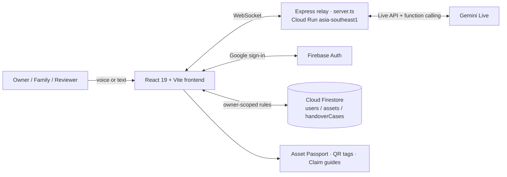

# ReclaimAI — Financial Legacy & Handover Platform

**Google Cloud AI Builder Cup 2026 · Theme: BFSI — Intelligent Risk, Fraud & Financial Experiences**

**Live demo:** https://reclaimai-795857022881.asia-southeast1.run.app/
**Health check:** `/api/health`

> Prototype. All people, institutions, balances and registry records in the demo are fictional.
> Do not enter real account numbers or personal data. ReclaimAI does not give legal, financial or estate-planning advice.

---

## The problem

When someone dies or becomes incapacitated, their family often does not know which accounts, deposits, policies, lockers or pensions exist, where the papers are kept, or who the nominee is. Money ends up dormant and is eventually moved to central unclaimed-deposit funds: in India, the RBI's Depositor Education and Awareness (DEA) Fund held about ₹78,000 crore of unclaimed deposits as of March 2024, which is why the RBI built the UDGAM portal. Singapore, Japan and Korea have similar dormant-account regimes.

The gap is not only search. It is that nobody kept a record while the owner was alive, and there is no safe, governed way to hand that record to the family later.

## The solution — three stages

| Stage | What happens |
|---|---|
| **1. Prepare** | The owner describes assets by **voice**, in their own language. Gemini turns the conversation into structured records: institution, type, amount, nominee and where the papers are physically kept. |
| **2. Handover** | The family sees only emergency contacts and document locations. Balances are released only after **two independent reviewers** approve the death or incapacity evidence. |
| **3. Recover** | Heirs search registry data for dormant balances and get a per-institution claim checklist for India, Singapore, Japan and South Korea. |

## How Gemini is used

**Voice Concierge (live).** The browser streams audio to an Express server, which relays it over WebSocket to the **Gemini Live API** (`@google/genai`).
- Gemini replies in audio and uses **function calling** to create asset records.
- Each record is saved straight into the shared ledger.
- It works in eight languages, including English, Hindi, Japanese, Korean and Thai.
- The tool schema tells the model to leave a field empty when the user did not state it, rather than guess.

The voice panel also accepts typed prompts, which go through the same Live session and tool call.



## What is real vs. demo

Being explicit so judges can verify everything we claim.

| Feature | Status |
|---|---|
| Voice Concierge (Gemini Live, audio, function calling, multilingual) | **Live** |
| Typed prompts in the Voice panel → same Gemini tool call | **Live** |
| Google sign-in + Firestore persistence (owner-scoped security rules) | **Live** (signed-in users) |
| Deployment on Google Cloud Run | **Live** |
| Workspace ledger, relationship graph, Family Portal, Asset Passport (3 audiences) | **Working UI**, on demo data |
| Dual-reviewer console (two keys, hold/resume/reject, audit trail) | **Working in the browser**; the case is not yet stored on the server |
| Legacy Chat (text tab) | **Scripted demo.** For live extraction, use the Voice panel's text box |
| Dormant-asset recovery | **Synthetic registry stand-ins**; match scores are preset demo values |
| Claim guides (IN / SG / JP / KR) | Curated checklists; **may be incomplete or out of date** |
| Passport "seal" | **Placeholder string**, not a real cryptographic hash |
| QR tags | Base64-encoded JSON, **not encrypted or signed** |
| Analytics & audit stream | **Illustrative**. No BigQuery or Pub/Sub pipeline exists yet |

## Tech stack

- **Frontend:** React 19, TypeScript, Vite, Tailwind CSS v4, Motion, lucide-react, qrcode.react
- **Backend:** Express + `ws` WebSocket relay (`server.ts`)
- **AI:** Gemini Live API via `@google/genai` (audio responses, function calling)
- **Google Cloud / Firebase:** Cloud Run (asia-southeast1), Firebase Authentication, Cloud Firestore
- Scaffolded in Google AI Studio from the `google-gemini/aistudio-repository-template`

## Run locally

Prerequisites: Node.js 20+, a Gemini API key, a Firebase project with Google sign-in and Firestore enabled.

```bash
git clone https://github.com/supermanyu90/ReclaimAI_New.git
cd ReclaimAI_New
npm install
cp .env.example .env        # add GEMINI_API_KEY
# replace firebase-applet-config.json with your own Firebase web config
npm run dev
```

Check `GET /api/health`. It should return `"apiKeyConfigured": true`.

## Repository map

| Path | Purpose |
|---|---|
| `server.ts` | Express server and WebSocket relay to Gemini Live |
| `src/App.tsx` | App shell, navigation, personas, auth |
| `src/components/` | One view per module (Voice, Workspace, Passport, QR, Reviewers, Claims, Recovery, Analytics) |
| `src/data/demoData.ts` | Fictional demo portfolio |
| `src/i18n/translations.ts` | UI translations |
| `firestore.rules`, `firebase-blueprint.json` | Firestore security rules and data model |

## Roadmap

1. Route the text chat through the same Gemini function-calling path as voice.
2. Store handover cases in Firestore, with dual approval enforced on the server.
3. Replace the placeholder seal with a real SHA-256 hash of the ledger snapshot, and use opaque QR tokens.
4. Gemini document extraction (deposit receipts, policy schedules) with per-field confidence and "not found" handling.
5. Real registry matching once partner data access exists; an evaluation set for extraction accuracy.
6. Audit events exported to BigQuery.

## Team

Built for the Google Cloud AI Builder Cup 2026 (Hack2skill).

## License

MIT — see [LICENSE](LICENSE).
